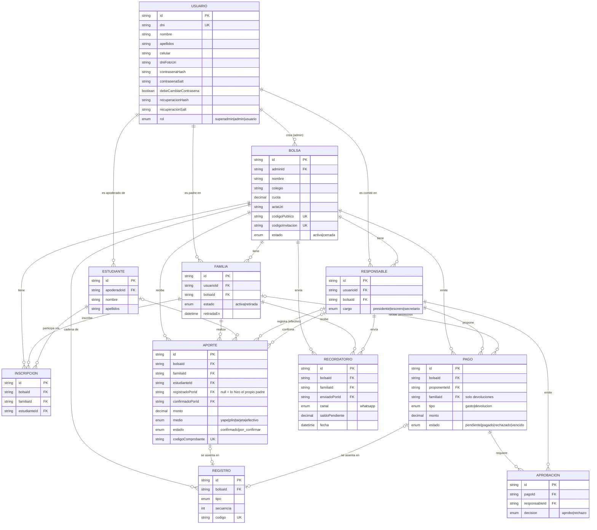

# Nuestra Bolsa — Diagrama ER

Modelo de datos con cuenta única. Separa la **identidad** de la persona (`Usuario`) de sus **membresías** por bolsa (`Familia`, `Responsable`), de modo que una persona y sus hijos puedan participar en varias bolsas (viaje de promoción, fiesta de promoción, etc.).

Implementado en la rama `refactor/schema`. El detalle de cada campo está en [base-de-datos-nuestra-bolsa.md](base-de-datos-nuestra-bolsa.md). Las secciones "Qué cambia respecto al modelo actual" y "Cuidados al migrar" describen la migración desde el modelo anterior.

## Diagrama

## Restricciones únicas

| Tabla | Restricción | Por qué |
| --- | --- | --- |
| Usuario | `dni` | Una persona, una cuenta |
| Familia | `(bolsaId, usuarioId)` | Un padre no se une dos veces a la misma bolsa |
| Responsable | `(bolsaId, usuarioId)` | Una persona no tiene dos cargos en la misma bolsa |
| Responsable | `(bolsaId, cargo)` | Un presidente, un tesorero y un secretario por bolsa |
| Inscripcion | `(bolsaId, estudianteId)` | Un hijo no se inscribe dos veces en la misma bolsa |
| Aprobacion | `(pagoId, responsableId)` | Un voto por responsable y pago |
| Registro | `(bolsaId, secuencia)` | Orden único de la cadena de cada bolsa |

## Decisiones de diseño

### Identidad única (`Usuario`)
- `Usuario` guarda DNI, nombre, apellidos, celular, foto del DNI y credenciales. Una sola contraseña por persona.
- `Usuario.rol` es **global**: `superadmin`, `admin` o `usuario`. El cargo del comité y el ser padre dependen de la bolsa y viven en las membresías.
- `Familia` y `Responsable` son **membresías independientes**: una misma persona puede ser padre y comité en la misma bolsa. El login autentica al usuario y luego pide elegir bolsa y membresía.
- Buscar por DNI al crear una bolsa es una consulta sobre `Usuario.dni`: si existe se reutiliza, y solo se pide contraseña y foto cuando es nuevo.

### Estudiantes en varias bolsas
- `Estudiante` pertenece a un apoderado (`Usuario`) y **no** a una bolsa.
- `Inscripcion` relaciona al estudiante con una bolsa a través de la familia. La cuota esperada de una familia en una bolsa es `cuota × número de inscripciones`.
- `Aporte.estudianteId` sigue siendo opcional (aporte general de la familia).

### Retiro de un padre
- `Familia.estado = retirada` y `retiradaEn` con la fecha. No se borra nada: se conservan aportes y cadena de registros.
- Una familia retirada no puede iniciar sesión en esa bolsa ni aparece en el CRM activo.
- La devolución de lo aportado es un `Pago` con `tipo = devolucion` y `familiaId`. Lo propone el tesorero y lo aprueban los demás con el flujo de aprobaciones existente.

### Aportes en efectivo mediados por el comité
- `Aporte.registradoPorId` apunta a `Responsable`. Si es `null`, lo registró el propio padre.
- Un aporte con `medio = efectivo` y `registradoPorId` no nulo se muestra como "Efectivo recibido por *nombre del responsable*". El nombre se guarda además como copia histórica (`registradoPorNombre`).
- Los campos `familiaNombre`, `estudianteNombre`, `proponenteNombre` y `responsableNombre` se mantienen como copia histórica: la cadena de registros no debe cambiar si alguien edita su nombre.

### Cargos
- `Responsable.cargo` (enum fijo) reemplaza a `rol` y `esTesorero`. Para validar que solo el tesorero proponga pagos basta comprobar `cargo = tesorero`.
- El formulario de creación de bolsa asigna los cargos directamente, sin dropdown.

### Recordatorios
- `Recordatorio` guarda quién lo envió, a qué familia, cuándo y el saldo pendiente en ese momento. Permite mostrar "último recordatorio hace N días" en el CRM.

### Carga masiva desde `.xlsx`
- Cada fila crea o reutiliza un `Usuario` por DNI, su `Familia` en la bolsa, los `Estudiante` del apoderado y sus `Inscripcion`.
- Contraseña inicial: el **DNI**, con `debeCambiarContrasena = true` para obligar a cambiarla en el primer ingreso. El DNI es un dato casi público, así que no debe quedar como contraseña definitiva.

## Qué cambia respecto al modelo actual

| Hoy | Propuesta |
| --- | --- |
| `Familia` y `Responsable` con nombre, DNI, celular y contraseña propios | Esos datos pasan a `Usuario`; las membresías solo guardan la relación |
| `Responsable.rol` + `esTesorero` | `Responsable.cargo` |
| `Estudiante` atado a una bolsa y una familia | `Estudiante` atado a un apoderado; `Inscripcion` lo une a cada bolsa |
| `Aporte.registradoPor` (texto) | `Aporte.registradoPorId` (FK a `Responsable`) |
| Borrado en cascada de la familia | `Familia.estado = retirada` |
| Sin devoluciones | `Pago.tipo` y `Pago.familiaId` |
| Sin historial de recordatorios | Tabla `Recordatorio` |
| `Bolsa.createdById` sin relación | `Bolsa.adminId` con FK a `Usuario` |

## Cuidados al migrar

- Hoy el mismo DNI puede existir en varias filas con contraseñas y nombres distintos. La migración debe unirlas por DNI y decidir qué contraseña prevalece.
- `Familia.nombre` es un solo campo; `Usuario` tiene `nombre` y `apellidos`. Hay que definir cómo se reparte al migrar.
- `recuperacionHash` y `recuperacionSalt` pasan de `Familia` a `Usuario`.
- La sesión (JWT) debe guardar `usuarioId` y, tras elegir bolsa, el `bolsaId` y el tipo de membresía.
- Todas las consultas que hoy usan `familia.nombre`, `familia.dni` o `responsable.nombre` deben pasar por la relación con `Usuario`.
